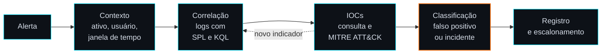

 

## `$ whoami`

Profissional de TI com mais de 2 anos em suporte técnico e redes em provedor de internet, agora em transição para cibersegurança, com foco em **monitoramento e resposta a incidentes**. Pratico de forma constante em laboratório: análise de logs no Splunk, investigações com KQL, Linux, ataques simulados em ambiente isolado e documentação de tudo aqui no GitHub.

Busco minha **primeira posição em SOC N1 ou Segurança da Informação**.

## `$ cat experiencia.log`

**Assistente de Suporte de TI · NewParce (provedor de internet) · 08/2022 a 12/2024**

| Na operação | Como isso ajuda no SOC |
| :-- | :-- |
| Diagnóstico de falhas de conectividade (TCP/IP, DNS e roteamento) para clientes residenciais e corporativos | Conhecer o tráfego normal para reconhecer o anômalo |
| Configuração e hardening básico de **mais de 1.000 roteadores** TP-Link e Nokia: credenciais padrão, DNS e abertura controlada de portas | Redução de superfície de ataque na prática |
| Registro e acompanhamento de chamados de incidente até a solução | Disciplina de documentação, passagem de contexto e acompanhamento |

## `$ ./investigar --alerta`

O fluxo que sigo nas investigações de laboratório (KC7 e Splunk), alinhado ao ciclo de resposta do NIST:

## `$ ls ./projetos`

**Segurança**

| Projeto | O que fiz | O que demonstra |
| :-- | :-- | :-- |
| **[GuardiAI](https://github.com/AhiPy/dio-agent-guardiai)** | Agente de IA para análise de vulnerabilidades e AppSec, com matriz de severidade e validação da correção. Projeto final do Bootcamp Santander | Análise de risco, CWE, OWASP, MITRE ATT&CK, IA aplicada |
| **[Força bruta em laboratório](https://github.com/AhiPy/brute-force-kali-medusa-)** | Medusa e Hydra contra FTP, login do DVWA e SMB (Kali × Metasploitable2), em rede isolada no VirtualBox, com passo a passo e mitigações | Visão do ataque e da defesa: bloqueio por tentativas, MFA, política de senhas |
| **[Simulação de malware em Python](https://github.com/AhiPy/laboratorio-ransomware-python)** | Estudo controlado de ransomware (criptografia com Fernet) e de captura de dados | Como esses ataques funcionam e como são detectados e prevenidos |

**Desenvolvimento**

| Projeto | Descrição | Stack |
| :-- | :-- | :-- |
| **auth-system** | CLI de autenticação com hash de senhas | Python, OOP, Repository Pattern, SQLite |
| **stock-manager** | CLI de gestão de estoque | Python, OOP, Repository Pattern, SQLite |
| **personal-library** | CLI de biblioteca pessoal | Python, OOP, Repository Pattern, SQLite |
| **[mcp-document-chat](https://github.com/AhiPy/mcp-document-chat)** | Servidor e cliente MCP com documentos locais | MCP |

> Todos os testes ofensivos foram feitos em ambiente próprio e isolado ou em plataformas autorizadas. O objetivo é entender o ataque para saber detectar e mitigar.

## `$ grep -r "pratica" ./labs`

| Ambiente | O que pratiquei |
| :-- | :-- |
| **[KC7 Cyber](https://kc7cyber.com/profile/AhiroSoc)** | Security Analyst I, 7 módulos: investigação de phishing e intrusões em logs com KQL, triagem de alertas e consulta de IOCs |
| **Splunk Enterprise (local)** | SPL, campos, janelas de tempo, dashboards, relatórios e alertas agendados |
| **OverTheWire Bandit** | Níveis 0 a 33: Linux, permissões, SSH e manipulação de dados |
| **PortSwigger Web Security Academy** | Vulnerabilidades web com Burp Suite |
| **TryHackMe, picoCTF e VulnHub** | Exercícios práticos, com anotações próprias |

## `$ ./stack --list`

| Área | Competências |
| :-- | :-- |
| **SOC e resposta** | Triagem e documentação de alertas (lab), ciclo de resposta NIST, noções de MITRE ATT&CK, engenharia social e phishing |
| **SIEM e logs** | Splunk Enterprise local (SPL, dashboards, alertas agendados), KQL no Azure Data Explorer, Wazuh em estudo |
| **Redes** | TCP/IP, IPv4/IPv6 e sub-redes, DNS, DHCP, roteamento, NAT, firewall/NGFW, Cisco IOS (configuração inicial), Nmap, Wireshark e tcpdump (lab) |
| **Linux** | CLI, usuários, grupos e permissões, SSH, arquivos e processos, Kali Linux, VirtualBox |
| **Testes em laboratório** | Burp Suite, Metasploit, Medusa, Hydra, enum4linux, Netcat, OpenSSL |
| **Programação** | Python (automação, OOP, SQLite), SQL, JavaScript/Node.js, Git/GitHub |

## `$ cat certificacoes.txt`

| Instituição | Certificação ou curso | Conclusão |
| :-- | :-- | :-- |
| **KC7 Cyber** | Security Analyst I (certificado nº 101009) | 11/2026 |
| **Cisco Networking Academy** | Dispositivos de Rede e Configuração Inicial | 11/2026 |
| **Cisco Networking Academy** | Conceitos Básicos de Redes | 10/2026 |
| **DIO** | Bootcamp Santander: Cibersegurança do Zero à Prática, 37 h (certificado nº DN0OYMRK) | 10/2026 |
| **Cisco Networking Academy** | Introdução à Cibersegurança | 09/2026 |
| **Google / Coursera** | Google Cybersecurity Certificate, 8 cursos (verificável no Credly) | Concluído |
| **Fortinet Training Institute** | Introduction to Next Generation Firewall; Cybersecurity and Cloud Fundamentals | Concluído |
| **Splunk Education** | Intro to Splunk, Using Fields, Working with Time, Visualizations, Scheduling Reports & Alerts | Concluído |

**Formação:** Tecnólogo em Análise e Desenvolvimento de Sistemas, UNIASSELVI (04/2022 a 12/2025).

---

**Tem uma vaga em SOC ou Segurança da Informação? Vamos conversar.**

[LinkedIn](https://www.linkedin.com/in/vinicius-henrique-dev/) · [E-mail](mailto:vinicius2001_henrique@hotmail.com)

Pequenos passos ainda são passos.

