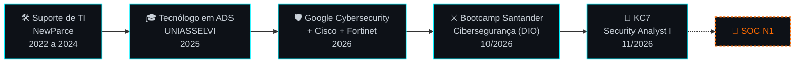

<div align="center">


**Segurança da Informação · SOC N1 · Redes · Linux · Python**


[](https://www.linkedin.com/in/vinicius-henrique-dev/)
[](https://kc7cyber.com/profile/AhiroSoc)
[](#-contato)

</div>

## `> whoami`

```console
ahipy@soc:~$ whoami
Vinicius Ferreira, de Naviraí (MS)
2,5 anos em suporte técnico e redes num provedor de internet
mais de 1.000 roteadores configurados, com troca de credenciais padrão e hardening básico
tecnólogo em ADS, em transição para cibersegurança
```

Passei dois anos e meio resolvendo incidente de conectividade para cliente residencial e corporativo. Foi aí que me interessei pelo outro lado: entender quem está na rede e o que não deveria estar lá. Hoje meu foco é **SOC N1**, com prática em laboratório, investigação em logs e **Python** para automatizar o que dá.

```console
ahipy@soc:~$ cat status.txt
> FOCO ......... SOC N1: triagem de alertas e resposta a incidentes
> PRÁTICA ...... KC7, Splunk local, laboratórios no VirtualBox
> ESTUDANDO .... Wazuh e a trilha Security Analyst II do KC7
> BUSCANDO ..... primeira vaga em SOC ou Segurança da Informação
> REGIME ....... remoto, híbrido ou presencial (disponível para mudança)
```

> *"Pequenos passos ainda são passos."*
>
> *"Vi coisas que vocês não acreditariam..."* (Blade Runner)

## `> ./destaque`

```console
ahipy@soc:~$ ./kc7 --career-path "Security Analyst I"
[✔] 7 de 7 módulos concluídos
[✔] investigação de phishing e intrusões em logs com KQL
[✔] triagem de alertas por severidade e consulta de IOCs
> certificado nº 101009 · KC7 Foundation · 11/2026
```

[](https://kc7cyber.com/profile/AhiroSoc)

## `> ./skills`

**Defesa e monitoramento**

-0d1117?style=for-the-badge&logo=splunk&logoColor=00f0ff)


-0d1117?style=for-the-badge&logoColor=00f0ff)

**Laboratório ofensivo** <sub>(sempre em ambiente isolado)</sub>


**Redes**


**Programação e sistemas**


**IA aplicada**


## `> ./projetos`

**Segurança**

| Projeto | O que fiz | Stack |
| :-- | :-- | :-- |
| [**brute-force-kali-medusa-**](https://github.com/AhiPy/brute-force-kali-medusa-) | Força bruta com Medusa e Hydra contra FTP, login do DVWA e SMB em rede isolada. Documentei o passo a passo e as mitigações: bloqueio por tentativas, MFA e política de senhas | Kali · Metasploitable2 · DVWA · VirtualBox |
| [**dio-agent-guardiai**](https://github.com/AhiPy/dio-agent-guardiai) | Agente de IA que analisa vulnerabilidades como um analista: entende o contexto, mede a severidade, corrige e valida. Inclui um lab de SQL Injection com teste automático que prova a mitigação | AGENTS.md · Python · CWE / OWASP / ATT&CK |
| [**laboratorio-ransomware-python**](https://github.com/AhiPy/laboratorio-ransomware-python) | Estudo controlado de ransomware (criptografia com Fernet), com foco em como esse ataque é detectado e prevenido | Python · cryptography |

**Desenvolvimento**

| Projeto | O que fiz | Stack |
| :-- | :-- | :-- |
| [**auth-system**](https://github.com/AhiPy/auth-system) | CLI de autenticação com senhas em hash SHA-256 | Python · OOP · Repository Pattern · SQLite |
| [**stock-manager**](https://github.com/AhiPy/stock-manager) | CLI de gestão de estoque | Python · OOP · Repository Pattern · SQLite |
| [**personal-library**](https://github.com/AhiPy/personal-library) | CLI de biblioteca pessoal | Python · OOP · Repository Pattern · SQLite |
| [**mcp-document-chat**](https://github.com/AhiPy/mcp-document-chat) | Servidor e cliente MCP para conversar com documentos locais | MCP · Python |

## `> ./trajetoria`



## `> ./formacao`

**Tecnólogo em Análise e Desenvolvimento de Sistemas** · UNIASSELVI · 04/2022 a 12/2025

**Bootcamp Santander: Cibersegurança do Zero à Prática** · DIO · 37 h · 10/2026

**Certificações e cursos**

- **KC7 Cyber:** Security Analyst I · 7 módulos · 11/2026
- **Google Cybersecurity Certificate:** Coursera · 8 cursos · verificável no Credly
- **Cisco Networking Academy:** Introdução à Cibersegurança (09/2026), Conceitos Básicos de Redes (10/2026) e Dispositivos de Rede e Configuração Inicial (11/2026)
- **Fortinet Training Institute:** Introduction to Next Generation Firewall · Cybersecurity and Cloud Fundamentals
- **Splunk Education:** Intro to Splunk · Using Fields · Working with Time · Visualizations · Scheduling Reports & Alerts
- **Inglês:** intermediário · curso de 300 h na Fluency · 07/2026

**Formação complementar:** Mapa do Arquiteto *(em conclusão)*

## `> ./hands-on`


-0d1117?style=for-the-badge&logo=splunk&logoColor=00f0ff)

## `> ./proximo-alvo`

```console
ahipy@soc:~$ cat roadmap.txt
[✔] Google Cybersecurity Certificate
[✔] Bootcamp Santander de Cibersegurança (DIO)
[✔] KC7: Security Analyst I
[~] Wazuh em laboratório, com Sysmon numa VM Windows
[ ] KC7: Security Analyst II
[ ] detectar o meu próprio brute force no Splunk (MITRE T1110) e documentar como relatório de incidente
```

## `> ./telemetria`

<table>
  <tr>
    <td></td>
    <td></td>
  </tr>
</table>

<p align="center">
  
</p>

## `> ./contato`

[](https://www.linkedin.com/in/vinicius-henrique-dev/)
[](mailto:vinicius2001_henrique@hotmail.com)
[](https://kc7cyber.com/profile/AhiroSoc)

<div align="center">


*Pequenos passos ainda são passos.* ⚡

</div>
